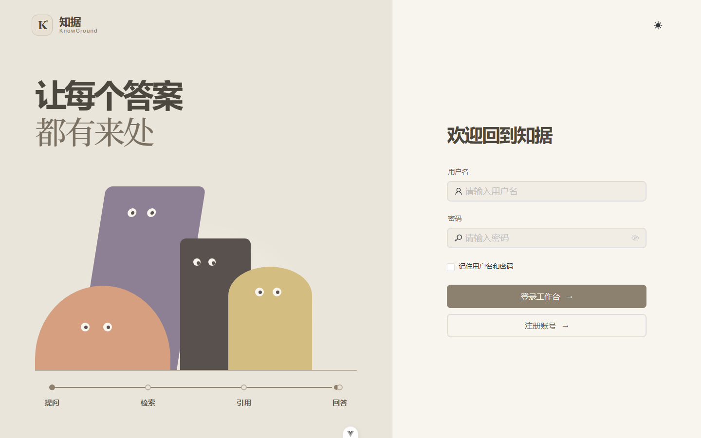
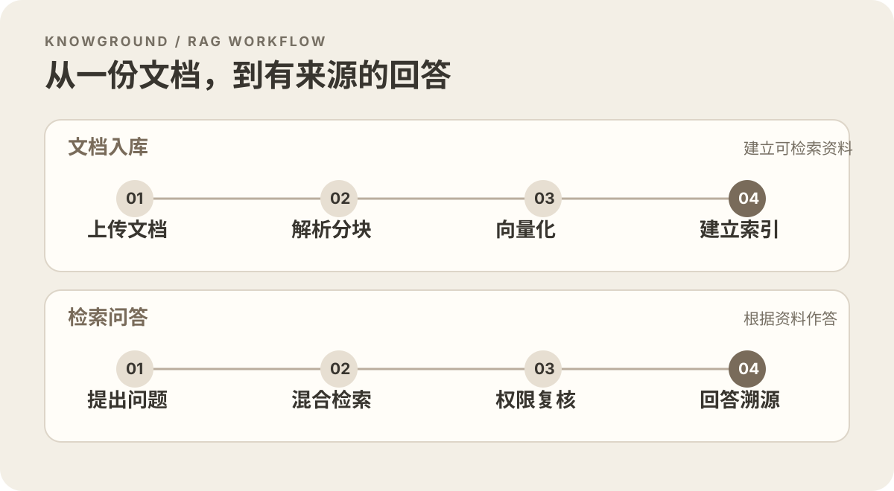
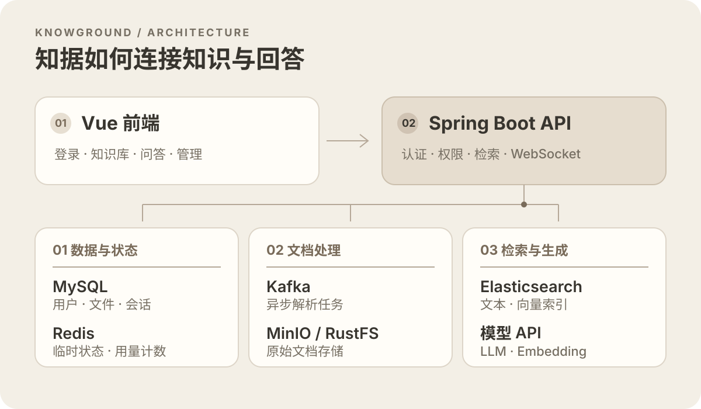

# 知据 · KnowGround

> 把散落在文档里的知识，变成有出处、可核对的回答。

知据是一个基于 **RAG（检索增强生成）** 的知识工作台。上传文档后，它会解析内容、切分文本并建立搜索索引；提问时，系统先从有权限访问的资料中检索相关片段，再交给大模型生成回答，并展示引用来源。适合个人学习资料、项目文档和团队知识的整理与问答。

项目在 PaiSmart 基础上持续开发，因此代码中仍保留部分 `smartpai` 包名和历史配置名称。本文按**当前仓库实际实现**介绍，不把规划中的功能写成已完成。

<p align="center">
  
</p>
<p align="center"><sub>登录页</sub></p>

## 目录

- [功能与使用场景](#功能与使用场景)
- [一次问答如何完成](#一次问答如何完成)
- [本轮迭代与技术文档](#本轮迭代与技术文档)
- [系统架构](#系统架构)
- [技术栈](#技术栈)
- [本地启动](#本地启动)
- [第一次使用](#第一次使用)
- [权限与用量](#权限与用量)
- [部署和项目结构](#部署和项目结构)
- [常见问题](#常见问题)
- [项目状态与贡献](#项目状态与贡献)

## 功能与使用场景

| 功能 | 用户能做什么 | 实现位置 |
| --- | --- | --- |
| 文档知识库 | 上传、查看、预览和管理文档；处理完成后参与问答 | `frontend/src/views/knowledge-base/`、`DocumentService` |
| 有来源的问答 | 提问、查看回答及其引用，点击来源核对原文 | `frontend/src/views/chat/`、`ChatHandler` |
| 混合检索 | BM25 与 KNN 并行召回，RRF 按名次融合，候选经 gte-rerank-v2 重排；失败时退回 RRF | `HybridSearchService`、`RrfFusion`、`RerankClient` |
| 上下文与父子检索 | 可选为分块生成上下文说明；命中小分块后补入相邻原文，引用仍指向命中分块 | `ChunkContextService`、`ParentContextExpander` |
| 文档冲突审核 | 相似分块候选检测、可选 LLM 确认和管理员决策 | `DocumentConflictService`、`frontend/src/views/document-conflicts/` |
| 离线评测 | 固定题集计算 Recall@K、MRR@K；评委评分和人工复核 | `scripts/rag_eval.py` |
| 可靠入库与任务恢复 | Outbox 投递、消费租约和幂等、心跳恢复、死信记录 | `FileTaskOutboxService`、`FileTaskRecoveryService` |
| 模型容错与问答预算 | 供应商限流、熔断、超时、有限重试与备用 LLM；ReAct 共用 120 秒预算 | `ModelCallGuard`、`ModelCallQueue`、`ChatHandler` |
| 对话记录 | 保存会话与历史消息，继续已有话题 | `ConversationService`、`frontend/src/views/chat-history/` |
| 用户与模型管理 | 账号、组织标签、模型配置和用量查看 | `frontend/src/views/` 对应页面 |
| 用量控制 | 普通用户受每日 Token 额度和分钟频率限制，提问及 Embedding 查询没有每日次数上限 | `UsageQuotaService`、`RateLimitService` 等服务及环境配置 |

当前可上传的文档扩展名由 `FileTypeValidationService` 控制，包含 `pdf`、`doc/docx`、`xls/xlsx`、`ppt/pptx`、`txt`、`md`、`html`、`csv` 等。不同格式的解析效果取决于原文件质量；扫描件还需要 OCR。图片、音视频、压缩包不能直接作为知识文档上传。

一个典型场景：把项目说明和会议纪要上传到知识库，然后问“这个项目的部署步骤是什么？”知据会先找相关文本片段，再组织答案。**答案不是权威事实本身**；请通过引用回到原文核对，尤其是版本、日期和配置项。

## 一次问答如何完成

这条链路分为两段：文档先完成入库并建立索引，提问时再检索可访问的内容生成回答。

<p align="center">
  
</p>

**入库阶段**：文件上传到 MinIO（云端使用兼容 S3 接口的 RustFS），元数据写入 MySQL。文件状态和 Outbox 消息在同一事务提交，随后投递 Kafka；消费者凭任务 ID 和租约处理解析、分块、向量化与 ES 入库。可选的上下文检索会在向量化前给分块补充说明。文件上传成功与“已经可以检索”是两个不同状态。PDF 解析支持 LiteParse；OCR 是可选能力。

**问答阶段**：用户问题先生成查询向量。Elasticsearch 并行执行 BM25 和 KNN 召回；RRF 按名次融合，再把前 50 条候选交给配置的 rerank 模型。rerank 不可用或时间不足时使用 RRF 顺序；向量生成失败时尝试纯文本检索。检索按本人、公开和有效组织标签过滤，返回结果前还会根据 MySQL 文件记录再次核对权限和冲突停用状态。Agent 工具把命中小分块和有上限的相邻原文交给 LLM，回答可带引用编号、文件名及页码。聊天通过 WebSocket 交互，历史记录保存在 MySQL。

> **关于开关与凭据**：上下文说明默认关闭，以免旧上传立即产生额外 LLM 费用；父子检索和 rerank 默认开启。rerank 需配置 `SEARCH_RERANK_API_KEY`，或由已激活的阿里云 Embedding 配置提供有效密钥；仅有代码和默认模型名不代表实际服务已可用。

## 本轮迭代与技术文档

下表按当前 `master` 的实现整理。具体算法、状态流转、配置和边界条件请读对应技术文档。

| 主题 | 当前实现 | 详细文档 |
| --- | --- | --- |
| 双路召回与上下文检索 | BM25 + KNN → RRF → rerank；可选上下文说明；命中后扩展相邻分块 | [RAG 检索技术说明](docs/rag-retrieval.md) |
| 离线 RAG 评测 | 检索和生成分别评估；评委与人工复核 | [离线评测操作手册](docs/rag-evaluation.md) |
| 冲突检测与审核 | 异步候选、可选 LLM 确认、管理员审核与检索停用 | [文档冲突检测](docs/document-conflict-detection.md) |
| Embedding 升级 | 版本索引构建、追平、抽样验证、ES 别名切换与回滚 | [索引迁移与回滚](docs/embedding-index-migration.md) |
| 异步文件处理 | Outbox、消费幂等、心跳恢复、废弃上传清理 | [可靠性与恢复](docs/file-processing-reliability.md) |
| 模型与 Agent 稳定性 | 令牌桶、有限重试、熔断、备用 LLM、请求总截止时间 | [模型调用容错](docs/model-call-resilience.md) |

部署前需要按环境核对[数据库迁移清单](docs/README.md#数据库迁移清单)；`ddl-auto=update` 的开发环境与手工迁移的生产环境不是同一种操作方式。

## 系统架构

浏览器只连接知据的 API；后端再使用数据与状态、文档处理、检索与生成三组服务。

<p align="center">
  
</p>

| 组件 | 作用 | 本地默认访问方式 |
| --- | --- | --- |
| Vue 前端 | 登录、知识库、聊天与管理页面 | `http://localhost:9527` |
| Spring Boot API | 认证、上传、检索、聊天、额度与权限 | `http://localhost:8081/api/v1` |
| MySQL | 用户、文件元数据、文档分块、会话与业务记录 | `.env` 中的 `SPRING_DATASOURCE_URL` |
| Redis | 临时状态、缓存、用量计数和 Lua 令牌桶 | `SPRING_DATA_REDIS_HOST/PORT` |
| Kafka | 文档处理的异步消息 | `SPRING_KAFKA_BOOTSTRAP_SERVERS` |
| Elasticsearch | 文本与向量索引 | `ELASTICSEARCH_HOST/PORT` |
| MinIO / RustFS | 原始文档对象存储 | `MINIO_ENDPOINT` |
| 模型 API | LLM 回答与 Embedding 向量化 | `DEEPSEEK_*`、`EMBEDDING_*` |

本地与云端的端口和地址**不是同一套**。云端由 Caddy 提供 HTTPS 静态页面和反向代理，基础设施服务在 Docker 私有网络内；具体映射见[云端部署手册](deployment/cloud/README.md)。

## 技术栈

| 层 | 主要技术 |
| --- | --- |
| 前端 | Vue 3、TypeScript、Vite、Pinia、Naive UI |
| 服务端 | Java 17、Spring Boot 3.4.2、Spring Security、Spring WebSocket |
| 数据与队列 | MySQL 8、Redis、Kafka |
| 搜索与存储 | Elasticsearch、MinIO；云端对象存储为 RustFS |
| 文档处理 | Apache Tika、LiteParse；按需配置 OCR |
| 模型接入 | OpenAI 兼容 LLM/Embedding 接口、DashScope rerank、Resilience4j；可在模型配置页管理提供方 |

## 本地启动

### 1. 准备环境

需要 JDK 17、Maven、Node.js **18.20+**、pnpm **8.7+**，以及可访问的 MySQL、Redis、Kafka、Elasticsearch、MinIO。还需要可用的 LLM 和 Embedding API Key 才能完整体验解析与问答。

仓库提供开发用的 [`docs/docker-compose.yaml`](docs/docker-compose.yaml)，但它不是开箱即用的公网编排；请先检查其中端口、密码、卷和服务版本。也可以自行运行这些依赖。Redis/Kafka 如果部署在虚拟机里，`.env` 必须写宿主机**实际可达**的虚拟机地址，不能机械填写 `localhost`。启动前请自行确认依赖实际可用，不要根据文档假定它们正在运行。

### 2. 配置后端

在项目根目录复制 [`.env.example`](.env.example) 为 `.env`，填写环境变量。PowerShell 示例：

```powershell
Copy-Item .env.example .env
```

Bash 示例：

```bash
cp .env.example .env
```

至少核对下表中的变量；完整说明以 `.env.example` 为准。

| 分类 | 关键变量 | 说明 |
| --- | --- | --- |
| 数据库 | `SPRING_DATASOURCE_URL`、`SPRING_DATASOURCE_USERNAME`、`SPRING_DATASOURCE_PASSWORD` | 指向已有且可写的 MySQL 数据库；示例库名为 `PaiSmart` |
| Redis / Kafka | `SPRING_DATA_REDIS_*`、`SPRING_KAFKA_BOOTSTRAP_SERVERS` | 确保后端进程能连接到实际地址 |
| 搜索 | `ELASTICSEARCH_*` | 配置主机、协议、账户及密码；生产环境不要开启不安全证书信任 |
| 对象存储 | `MINIO_ENDPOINT`、`MINIO_ACCESS_KEY`、`MINIO_SECRET_KEY`、`MINIO_BUCKET_NAME` | 指向 MinIO 或 S3 兼容服务 |
| 认证 | `JWT_SECRET_KEY` | 使用随机的 Base64 密钥；可通过 `openssl rand -base64 32` 生成 |
| 模型 | `DEEPSEEK_API_KEY`、`EMBEDDING_API_KEY` | 需要各自的有效凭证；模型名称可在样例文件中调整 |
| 注册 | `APP_AUTH_REGISTRATION_MODE` | `OPEN` 允许正常注册；也支持 `INVITE_ONLY`、`CLOSED` |

**不要把 `.env`、云端 `.env.cloud`、真实 API Key、数据库备份或用户上传文件提交到 Git。** `.env.example` 是占位配置，并非真实凭证。

首次启动若需创建管理员，可暂时设置 `ADMIN_BOOTSTRAP_ENABLED=true` 并配置强密码；账号建好后改回 `false`，重启应用。普通用户在 `OPEN` 模式下可从注册页注册，不要求邀请码。

### 3. 启动后端与前端

在项目根目录运行后端：

```bash
mvn spring-boot:run
```

另开终端运行前端：

```bash
cd frontend
pnpm install
pnpm dev
```

浏览器访问 [`http://localhost:9527/#/login`](http://localhost:9527/#/login)。本地 Vite 开发配置默认连接 `http://localhost:8081/api/v1`；如果后端地址不同，修改 `frontend/.env.test` 的 `VITE_SERVICE_BASE_URL` 和 WebSocket 地址。

> Windows 用户注意：前后端需要分别保持运行。IDE 启动的后端通常支持热加载；修改 Java 代码后先执行 `mvn -q -DskipTests compile`，确认实际运行版本仍旧时再重启后端。浏览器刷新不能替换仍占用 8081 端口的旧进程。

## 第一次使用

| 步骤 | 操作 | 应看到的结果 |
| --- | --- | --- |
| 1 | 注册或使用管理员账号登录 | 进入工作台 |
| 2 | 在知识库上传一份可公开测试的 PDF、MD 或 TXT | 文件出现在列表中；等待解析状态完成 |
| 3 | 打开知识问答，提出文档中有明确答案的问题 | 返回回答和相关来源；点击来源可查看原文 |
| 4 | 查看聊天记录 | 刚才的会话可以继续打开 |
| 5 | 用第二个账号测试私有文档 | 私有资料不应被其他账号通过检索读到 |

例如可以上传一份**不含真实密钥的测试文档**，写上“项目部署前先检查 MySQL、Redis、Kafka 和 Elasticsearch 的连接”，然后提问“部署前要检查哪些服务？”。这是操作示例，不是仓库内置数据，也不代表模型每次都会返回完全相同的措辞。

## 权限与用量

检索权限包含**上传者本人、公开文档和用户有效组织标签**三种来源；组织标签的上级继承也参与匹配。应以实际文件组织标签和用户关系核对可见范围，不能把“私有”简单理解成绝对仅本人可见。检索索引中的旧记录还要通过数据库再次复核。管理员冲突决策停用的文档会从检索结果排除。既有历史对话若引用了当前无权访问的资料，读取历史时会隐藏相关回答；这不会自动物理删除旧记录。

`.env.example` 提供的公网试运行额度如下。实际运行值以部署环境变量为准。提问与 Embedding 查询没有每日次数上限，仍受分钟频率限制。

| 项目 | 新用户赠送 | 每日上限 |
| --- | ---: | ---: |
| LLM Token | 20,000 | 10,000 |
| Embedding Token | 10,000 | 3,000 |

赠送额度是初始余额，每日上限是当天消耗限制，两者不是一回事。管理员账号在当前实现中豁免这些日常使用限制；普通用户按配置计数。公网部署前请结合模型价格、并发和滥用风险重新评估这组默认值。

## 部署和项目结构

仓库提供 [Docker 云端部署手册](deployment/cloud/README.md)、[Compose 编排](deployment/cloud/compose.yaml) 和 [Dockerfile](deployment/cloud/Dockerfile.api)。云端示例使用 Caddy 提供 HTTPS 与反向代理，MySQL/Redis/Kafka/Elasticsearch 运行在容器私有网络，原文件放在 RustFS。部署前先准备 `.env.cloud`，检查域名、证书、端口、数据卷及密钥；不要照搬作者的服务器地址和数据迁移记录。

```text
KnowGround/
├── frontend/                   # Vue 3 页面、组件和前端配置
├── src/main/java/              # Spring Boot 后端
├── src/main/resources/         # 应用配置与索引映射等资源
├── src/test/                   # 后端测试
├── docs/
│   ├── images/                 # README 使用的截图和流程图
│   ├── databases/              # 数据库脚本
│   └── docker-compose.yaml     # 本地开发用依赖示例
├── deployment/cloud/           # 云端 Compose、镜像与运维说明
├── .env.example                # 本地配置模板
└── README.md
```

## 常见问题

| 现象 | 排查顺序 |
| --- | --- |
| 登录请求 `ECONNREFUSED` | 确认 8081 后端已启动，检查 Vite 代理目标、MySQL 和 Redis 连接 |
| 页面能开，但 AI 服务不可用 | 检查模型 API Key、模型名称、普通用户余额与每日额度、后端日志 |
| 上传后搜不到文件 | 等待 Kafka 消费和解析完成；检查对象存储、Embedding、ES 索引及文档可见性 |
| 其他账号搜到私有文档 | 确认实际运行的是最新后端；检查文件公开状态、历史对话与索引数据，避免只看前端显示 |
| PDF 是扫描件却没有正文 | 配置 LiteParse/OCR；确认解析进程能访问所需命令和语言包 |
| 改了后端代码却看不到变化 | 停止旧 Java 进程，重新启动；仅刷新浏览器不会更新 API |

开发时建议按 **登录 → 上传 → 解析 → 检索 → 引用预览 → 历史记录** 的顺序检查整条链路。页面返回 200 不代表依赖、模型调用和文档权限都已验证。

## 项目状态与贡献

知据仍在持续迭代。当前可以作为 RAG、Java 服务端与前端协作的学习项目；如果用于真实团队资料或公网服务，应先完成凭证隔离、备份恢复、权限回归、成本控制和全链路验收。欢迎通过 Issue 反馈可复现的问题，或提交聚焦单一改动的 Pull Request；附上触发步骤和相关日志会更容易定位。
