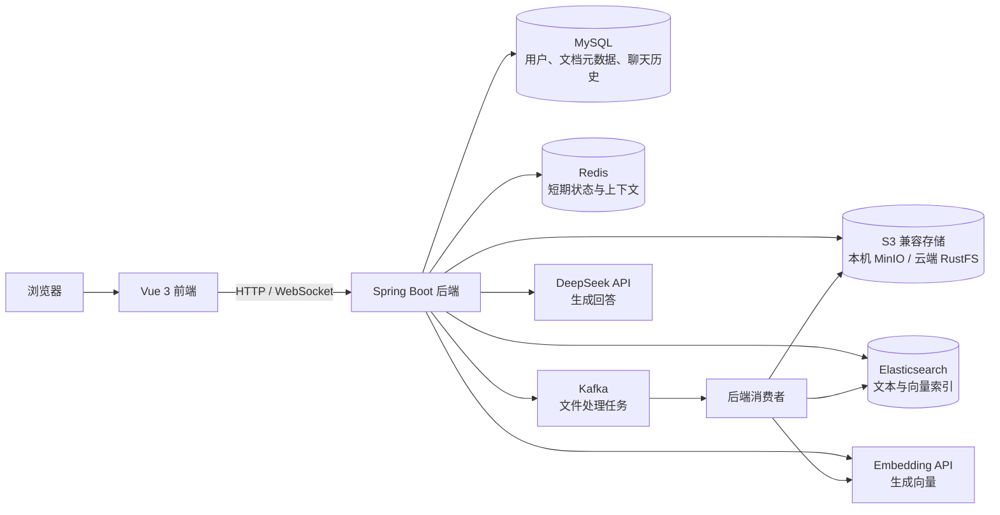
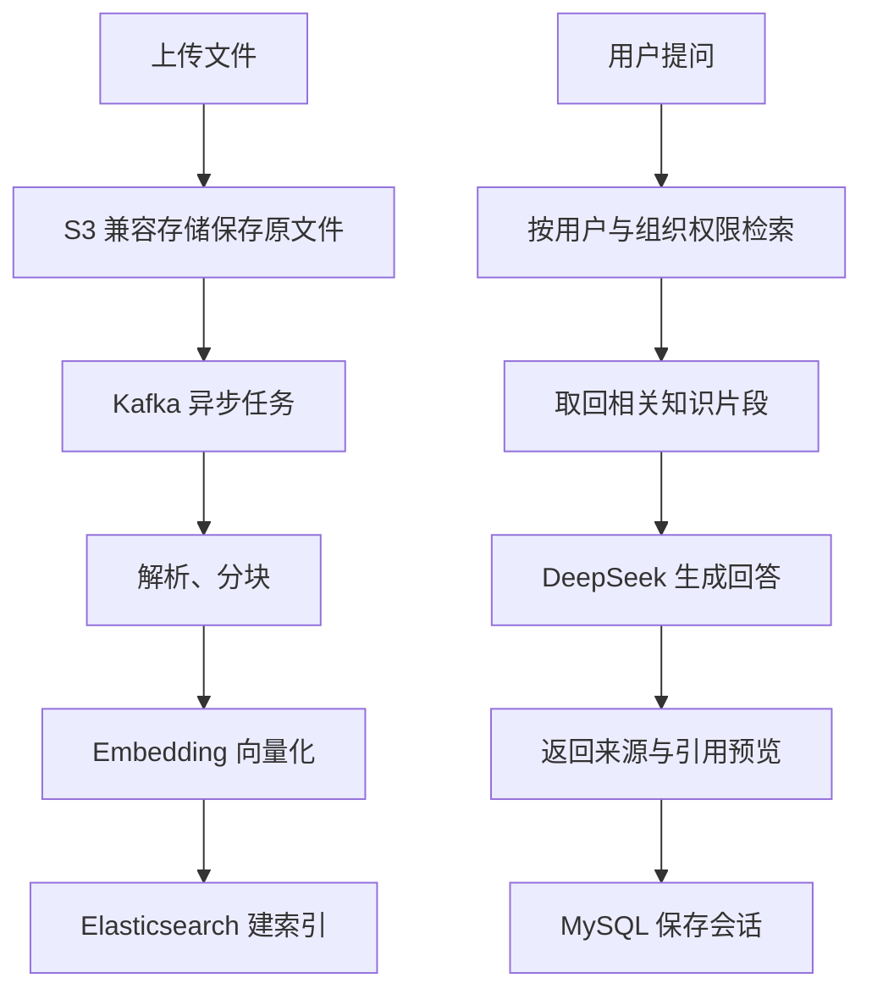

# 知据 · KnowGround


知据是我在 PaiSmart 代码基础上学习和开发的 RAG 知识库项目。它把文档上传、解析、检索和对话串起来，让回答可以回溯到文档来源。仓库仍保留部分 `PaiSmart` / `smartpai` 运行标识；本文描述当前代码与已验证的运行状态。


> 上图截自本地开发环境的 `/#/login`，不含账号和业务数据。知据入口是 `https://jymcode.top/rag/`；服务器管理面板在 `https://jymcode.top/server/`。

## 导航

- [功能与页面](#功能与页面)
- [系统架构](#系统架构)
- [技术栈](#技术栈)
- [本地开发](#本地开发)
- [项目结构](#项目结构)
- [云端部署与数据迁移](#云端部署与数据迁移)
- [验证与排障](#验证与排障)
- [项目来源](#项目来源)

## 功能与页面

| 功能 | 当前代码中的实现 | 主要入口 |
| --- | --- | --- |
| 登录与权限 | Spring Security、JWT；注册模式支持开放、邀请码和关闭 | `AuthController`、`UserController`、登录页 |
| 知识库 | 上传、文档管理、解析、分块、向量化和访问权限控制 | `UploadController`、`DocumentController`、知识库页 |
| 检索问答 | 混合检索后调用模型生成回答，传递引用映射 | `HybridSearchService`、`ChatHandler`、聊天页 |
| 对话历史 | 会话、消息和引用信息写入 MySQL | `ConversationService`、聊天历史页 |
| 组织与管理 | 组织标签、用户、邀请码、模型提供方、额度与用量页面 | 管理相关控制器及 `frontend/src/views/` |

这些功能能否完整使用，取决于数据库、队列、对象存储、检索服务和模型 API 是否配置正确。页面或类存在不等于整条业务链路已通过测试。

## 系统架构

### 服务关系



### 上传与提问的两条链路



**数据分工：**MySQL 保存需要长期保留的业务数据和聊天历史；本机 MinIO、云端 RustFS 保存文件；Elasticsearch 保存可检索索引；Redis 用于短期状态，不应当作聊天历史的唯一存储。Kafka 承接异步任务。

## 技术栈

| 分类 | 版本或组件 | 在项目中的作用 | 配置/代码依据 |
| --- | --- | --- | --- |
| 后端 | Java 17 编译目标、云端 Java 21、Spring Boot 3.4.2、Maven | API、业务逻辑和 WebSocket | [`pom.xml`](pom.xml)、[`Dockerfile.api`](deployment/cloud/Dockerfile.api) |
| 前端 | Vue 3、TypeScript、Vite 6、Naive UI、Pinia、Vue Router、UnoCSS、pnpm | 页面与状态管理 | [`frontend/package.json`](frontend/package.json) |
| 数据库 | MySQL 8、Spring Data JPA | 用户、文档元数据、会话与记录 | [`application.yml`](src/main/resources/application.yml) |
| 缓存/消息 | Redis、Spring Kafka、Apache Kafka | 短期生成状态与异步文件处理 | 后端配置和消费者代码 |
| 搜索/文件 | 云端 Elasticsearch 8.10.4、RustFS；本机 MinIO | 混合检索、向量索引与原文件 | [`deployment/cloud/compose.yaml`](deployment/cloud/compose.yaml) |
| 文档解析 | Apache Tika、PDF 处理代码、LiteParse `lit` | 文本提取和 PDF 解析 | `DocumentService`、`ParseService` |
| AI | DeepSeek API、DashScope Embedding API | 回答生成与向量化 | `DeepSeekClient`、`EmbeddingClient` |
| 安全 | Spring Security、JWT | 身份认证与访问控制 | `SecurityConfig` |

部署镜像版本可能和 Maven 客户端依赖版本不同；以部署文件中实际镜像为准。Beszel 是独立的服务器监控软件，不参与 RAG 问答。

## 本地开发

### 环境要求

| 工具/服务 | 建议版本或说明 |
| --- | --- |
| JDK | 17 |
| Maven | 3.8.6 或更新 |
| Node.js / pnpm | Node.js 18.20+、pnpm 8.7+ |
| MySQL / Redis / Kafka / Elasticsearch / MinIO | 配置可用的本机或开发实例；Elasticsearch 示例镜像为 8.10.4 |
| 模型服务 | 有效的 DeepSeek 与 Embedding API Key；没有 Key 时无法验证完整问答链路 |
| PDF 解析 | 使用该功能时需让后端能执行 LiteParse 的 `lit` 命令 |

### 1. 准备基础设施

先确认 MySQL、Redis、Kafka、MinIO 和 Elasticsearch 可以从后端所在机器访问。仓库中的 [`docs/docker-compose.yaml`](docs/docker-compose.yaml) 是原有基础设施示例，带固定密码、对外映射端口和宿主机路径，**不能原样用于公网服务器**。本地使用也应先检查其端口、凭据、数据卷和 Elasticsearch 内存占用。

数据库名由 `SPRING_DATASOURCE_URL` 决定；示例文件中的库名和你本机现有库名可能不同，启动前保持一致。`docs/databases/ddl.sql` 可供查看原有表结构，但实际建表策略仍以当前 JPA 配置和迁移后的数据库状态为准。

### 2. 配置后端

从 [`.env.example`](.env.example) 复制一份为仓库根目录 `.env`。Windows PowerShell 可以执行：

```powershell
Copy-Item .env.example .env
```

Linux/macOS 可以执行：

```bash
cp .env.example .env
```

仓库中的 `DotenvEnvironmentPostProcessor` 会在从项目根目录启动后端时读取 `.env`。真实 `.env` 已被 `.gitignore` 排除，不能提交到仓库或发到聊天里。重点填写：

| 配置项 | 用途 | 常见问题 |
| --- | --- | --- |
| `SPRING_PROFILES_ACTIVE` | 本地通常为 `dev` | 选错 profile 会读到不同默认值 |
| `SPRING_DATASOURCE_URL`、`SPRING_DATASOURCE_USERNAME`、`SPRING_DATASOURCE_PASSWORD` | MySQL 连接 | 库名、账号或权限不匹配 |
| `SPRING_DATA_REDIS_HOST`、`SPRING_KAFKA_BOOTSTRAP_SERVERS` | Redis 与 Kafka | 服务在虚拟机时不要误填 `localhost` |
| `MINIO_ENDPOINT`、`MINIO_PUBLIC_URL`、`MINIO_ACCESS_KEY`、`MINIO_SECRET_KEY` | 原文件与下载地址 | 内外地址不一致可能影响签名 URL |
| `ELASTICSEARCH_HOST`、`ELASTICSEARCH_SCHEME`、`ELASTICSEARCH_PASSWORD` | 检索连接 | HTTP/HTTPS 和证书配置不一致 |
| `JWT_SECRET_KEY` | JWT 签名 | 必须提供有效的 Base64 密钥 |
| `DEEPSEEK_API_KEY`、`EMBEDDING_API_KEY` | 模型调用 | 额度、模型名、向量维度需匹配 |
| `FILE_PARSING_LITEPARSE_COMMAND` | PDF 解析命令 | 后端进程找不到 `lit` |

前端使用 [`frontend/.env.test`](frontend/.env.test) 和 [`frontend/.env.prod`](frontend/.env.prod) 分别配置开发/生产接口地址。`pnpm dev` 走 `test` 模式，默认连接 `http://localhost:8081/api/v1`。

### 3. 启动项目

后端通常由 IDE 直接运行；也可在仓库根目录运行：

```bash
mvn spring-boot:run
```

另开终端运行前端：

```bash
cd frontend
pnpm install
pnpm dev
```

| 地址 | 作用 |
| --- | --- |
| `http://localhost:9527/#/login` | 本地前端登录页 |
| `http://localhost:9527/#/chat` | 聊天页，需登录 |
| `http://localhost:9527/#/knowledge-base` | 知识库页，需登录 |
| `http://localhost:8081/api/v1` | 后端 API 前缀 |

登录后先做一次小文档上传与提问，验证 Kafka、MinIO、Embedding、Elasticsearch 和模型调用是否都通。只看到登录页不能说明 RAG 链路已正常。

### 日常开发命令

```bash
# 修改 Java 后优先编译，让已有的 IDE 热部署加载最新代码
mvn -q -DskipTests compile

# 需要验证后端行为时
mvn test

# 在 frontend 目录中执行
pnpm typecheck
pnpm build
```

本地开发时后端通常由 IDE 管理，不要仅为验证一处代码修改就先重启。前端开发服务器已运行时直接访问 `http://localhost:9527`。

## 项目结构

```text
KnowGround/
├── src/main/java/com/yizhaoqi/smartpai/  # 后端控制器、服务、消费者与模型客户端
├── src/main/resources/                 # application*.yml 与静态资源
├── frontend/src/views/                 # 聊天、历史、知识库和管理页面
├── frontend/packages/                  # 前端工作区模块
├── docs/                               # 数据库脚本和开发/部署记录
├── deployment/server-console/          # 已部署的独立 VPS 管理面板资料
├── .env.example                        # 本地配置样例
├── .env.cloud.example                  # 云端配置样例，真实值不入库
├── pom.xml                              # Maven 依赖
└── README.md
```

| 配置文件 | 用途 |
| --- | --- |
| [`application.yml`](src/main/resources/application.yml) | 通用配置与知据应用的回答规则 |
| [`application-dev.yml`](src/main/resources/application-dev.yml) | 本地开发参数 |
| [`application-docker.yml`](src/main/resources/application-docker.yml) | 容器环境参数 |
| [`application-prod.yml`](src/main/resources/application-prod.yml) | 生产环境覆盖参数 |
| [`AGENTS.md`](AGENTS.md) | 本仓库内 Codex 的工作约定；不属于应用的系统提示词 |

## 云端部署与数据迁移

### 当前状态

| 项目 | 状态 |
| --- | --- |
| Ubuntu VPS、SSH、Docker、Docker Compose、HTTPS | 已准备 |
| 独立服务器管理面板与 Beszel 监控 | 已部署，见 [面板说明](deployment/server-console/README.md) |
| 知据应用的云端 Compose、前后端镜像 | 已部署；入口为 [jymcode.top/rag/](https://jymcode.top/rag/)，[服务器 IP](https://23.252.124.29/) 仍可访问 |
| MySQL、对象存储与检索索引 | 已复制 / 重建：15 张表、3 个文件、587 条检索文档；本机原数据保留 |
| 新域名的登录与旧文档预览 | 已由用户在浏览器验证；上传、问答与引用仍需逐项验收 |

云端编排使用 [`deployment/cloud/compose.yaml`](deployment/cloud/compose.yaml)，运维与回退命令见 [云端运行手册](deployment/cloud/README.md)。现有 [`docs/docker-compose.yaml`](docs/docker-compose.yaml) 是旧开发示例，不能用于当前 VPS。

### 本次部署顺序

1. 从本机只读导出 MySQL 与 MinIO 对象并校验 SHA-256；保留本机原件。
2. 使用独立的 [`.env.cloud.example`](.env.cloud.example) 对应云端配置，启动 MySQL、Redis、Kafka、RustFS、Elasticsearch 和后端；只让 Caddy 暴露 HTTPS。
3. 恢复 15 张表、3 个文件；本机 Elasticsearch 许可证过期，未修改本机许可证，而是从 MySQL 文本分块在云端重建 587 条索引。
4. 在 `jymcode.top/rag/` 提供知据，在同一域名的 `/server/` 提供管理面板；验证首页、API 限制、真实文件预签名下载及容器健康。

迁移采用**复制**：本机数据保留。云端只包含备份时间点的数据；本机后续新增内容不会自动同步。VPS 的 4 GB 内存对完整服务较紧张，需持续观察内存、swap 和磁盘。

### 已验证与待验证

| 项目 | 当前结果 |
| --- | --- |
| S3 兼容存储 | 云端使用仍在维护的 RustFS，后端保留 `MINIO_*` 配置名；合并对象和预签名下载已验证 |
| Elasticsearch IK 插件 | 与 ES 8.10.4 一起打入镜像，587 条索引重建成功 |
| `/api/v1/test/**` 和 `/api/v1/internal/ocr/**` | 已在公网 Caddy 返回 404 |
| LiteParse `lit`、PDF 上传与异步解析 | 后端镜像已成功解析真实迁移 PDF；**网页上传链路待验收** |
| 登录、问答、引用与历史 | 手机端已确认原账号登录、旧文档和历史可见；最近一次回答与引用映射已写入 MySQL，**页面展示和预览待确认** |

## 验证与排障

建议按“浏览器 → 后端 → 数据存储”逐层定位：

| 现象 | 优先检查 |
| --- | --- |
| 前端打不开 | `9527` 开发端口、Vite 进程、浏览器控制台 |
| 登录失败 | Network 中的响应、后端日志、MySQL 用户数据及 JWT 配置 |
| 上传后一直不完成 | MinIO 对象、Kafka topic/消费者、解析任务日志 |
| 聊天没有参考来源 | Elasticsearch 检索结果、权限过滤、引用映射与浏览器响应 |
| 历史记录为空 | 浏览器请求/响应、后端会话服务、MySQL 记录；不要只看 Redis |
| 云端网页正常但问答失败 | 容器健康、模型 API、Embedding API、ES、Kafka 和数据库连接 |

完整验收路径为“登录 → 上传 → 解析与向量化 → 检索问答 → 引用预览 → 历史记录”。前后端都要确认实际请求和持久化数据，不以页面能打开作为上线完成标准。

## 项目来源

知据在 PaiSmart 项目基础上继续学习和开发，保留了部分上游类名与目录结构。本 README 只描述本仓库的真实实现与状态，不引用原项目的商业推广、招聘成果或他人的截图。仓库根目录的 [`LICENSE`](LICENSE) 是 Apache License 2.0；前端依赖和其他第三方组件各自遵循其许可证。
