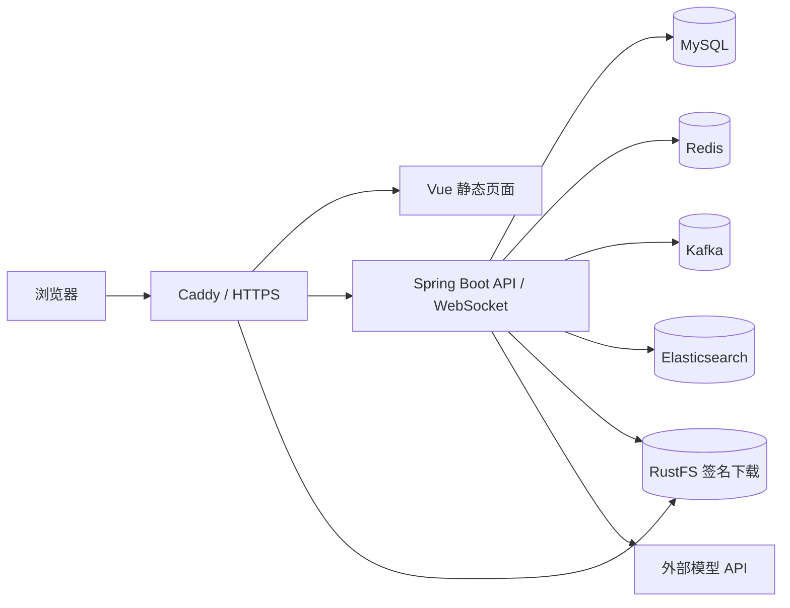

# 知据云端部署记录

> 更新于 2026-10-08。此文件记录迁移决策和已验证结果；日常操作、回退命令见 [云端运行手册](../deployment/cloud/README.md)。

## 环境与入口

| 项目 | 当前状态 |
| --- | --- |
| 服务器 | GreenCloud VPS，Ubuntu 24.04 LTS，2 vCPU / 4 GB RAM / 约 35 GB 磁盘，2 GB swap |
| 公网 | 知据入口为 `https://jymcode.top/rag/`，管理面板和 Beszel 在 `https://jymcode.top/server/`；纯 IP `https://23.252.124.29/` 仍可访问知据；旧 DuckDNS 服务器绑定已移除 |
| 服务 | Docker Compose 启动 MySQL、Redis、Kafka、RustFS、Elasticsearch、Spring Boot；Caddy 提供 HTTPS 和前端静态资源 |
| 内网隔离 | MySQL、Redis、Kafka、Elasticsearch 只在 Docker 网络；后端和 RustFS 仅映射到服务器 `127.0.0.1` |
| 配置 | 根目录 `.env.cloud` 是云端专用文件且被 Git 忽略；样例见 [`.env.cloud.example`](../.env.cloud.example) |

## 数据迁移结果

用户选择复制已有数据到云端并保留本机原件。本机 MySQL 使用只读导出；MinIO 通过 S3 API 导出对象与 SHA-256 清单。传输包在云端核对了 SHA-256 后才解压。云端恢复结果：

| 数据 | 数量或结果 |
| --- | ---: |
| MySQL | 15 张表；用户 2、文件 3、对话 20、文本分块 587、加密模型配置 2 |
| RustFS | 3 个对象，共 71,998,719 字节；真实文件经公网预签名地址下载后 SHA-256 一致 |
| Elasticsearch | `knowledge_base` 共 587 条索引文档，与 MySQL 分块数一致 |

本机 Elasticsearch 9.3.8 的许可证过期，读取旧索引返回 403。用户选择不修改本机许可证，因此云端 ES 8.10.4 使用原 MySQL 文本分块重新调用 Embedding API 生成向量。此过程没有重新解析 PDF，也没有改动本机索引。3 份文档共调用约 110,988 个 Embedding token。

本机 Redis 保存短期状态，未作为聊天历史来源复制。Kafka 也没有作为业务永久数据迁移。云端副本只包含备份时间点的数据；本机在此后新增的记录和文件不会自动同步。

## 已完成验证

- Docker Compose 六项长期服务的健康检查均通过；后端启动并返回 HTTP 200，ES IK 插件与 ES 8.10.4 一起构建。
- 后端镜像内 LiteParse 2.0.0 已在 896 MB 内存限制下成功解析一份真实迁移 PDF；镜像使用 Java 21 和 Node 22。
- Caddy 首页返回 200，旧 `/server/` 仍由 Authelia 保护；`/api/v1/test/**` 对公网返回 404。
- 纯 IP HTTPS 使用独立的 Let's Encrypt 短期 IP 证书与每日自动续期，续期演练成功；IP 首页与新域名 `/rag/` 均返回 200，用户已确认 IP 入口可以登录并预览/下载旧文档。IP 与域名的真实预签名文件下载均通过 SHA-256 校验。
- 通过实际迁移文件验证了 RustFS 的 S3 上传、合并对象、预签名下载与 Caddy 的 Host 签名转发。
- 导入的加密模型配置可解密；云端使用独立的 JWT 密钥。云端 Embedding API 已成功完成三份文档的索引重建。
- 旧 Caddy 配置保存在 `/etc/caddy/Caddyfile.pre-knowground-20261007`，可按运行手册回退。

## 仍需业务验收

手机端已确认能用原账号登录，并看到旧文档和聊天历史。最近一次云端问答已在 MySQL 保存回答和引用映射；仍需在浏览器确认回答显示、引用预览、PDF 上传及 Kafka 异步解析。LiteParse CLI 已通过真实 PDF 解析测试，但尚未通过网页上传验证。4 GB 内存对所有服务较紧，部署后观察到约 1.2 GB available RAM，swap 使用约 350–600 MB；高峰流量前应继续观察资源曲线及磁盘增长。
