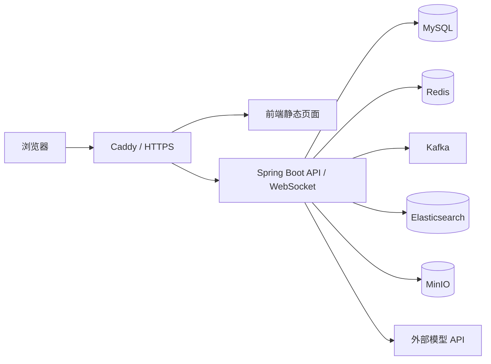

# 知据云端部署与数据迁移记录

> 更新于 2026-10-07。本文记录当前服务器条件、尚未完成的工作和迁移顺序；它不是已验证可直接执行的生产部署脚本。项目功能和本地开发方式见 [README](../README.md)。

## 当前服务器

| 项目 | 当前情况 |
| --- | --- |
| 服务商/系统 | GreenCloud VPS，Ubuntu Server 24.04 LTS，x86_64 |
| 资源 | 2 vCPU、4 GB 内存、约 35 GB 磁盘；另有 2 GB swap |
| 网络 | 公网 IPv4，DuckDNS 域名，Caddy 提供 HTTPS |
| 已安装 | Docker、Docker Compose v2、Caddy、服务器管理面板、Authelia、Beszel |
| 知据应用 | 尚未在 VPS 启动，业务数据也尚未迁移 |

服务器管理面板的具体配置和登录说明在 [`deployment/server-console/README.md`](../deployment/server-console/README.md)。监控面板的运行正常只代表 VPS 基础环境可用，不能作为知据已部署的证明。

## 目标结构

数据库、Redis、Kafka、MinIO 和 Elasticsearch 应放在 Docker 私有网络中，不向公网映射管理端口。公网只需要 HTTPS 和受控的 SSH。现有 Caddy 已承担面板入口，应用路由需要与现有 `/server/` 路由协调，避免覆盖管理面板。

4 GB 内存对完整 Java + MySQL + Redis + Kafka + MinIO + Elasticsearch 单机运行很紧张。原有 `docs/docker-compose.yaml` 给 Elasticsearch 配置了 2 GB 堆，不能原样搬上这台 VPS。新的 Compose 需要限制内存，实测空载、上传和向量化峰值；若持续换页或 OOM，应减少组件占用或升级实例。

## 现有文件及用途

| 文件 | 用途 | 当前结论 |
| --- | --- | --- |
| [`../.env.example`](../.env.example) | IDE/本地运行配置样例 | 可复制为本地 `.env` |
| [`../.env.cloud.example`](../.env.cloud.example) | 云端环境变量样例 | 需根据新 Compose 补齐真实值，不能提交填好密钥的文件 |
| [`../src/main/resources/application-docker.yml`](../src/main/resources/application-docker.yml) | 后端容器 profile | 已有服务地址环境变量，但需要与实际 Compose 服务名对齐 |
| [`../src/main/resources/application-prod.yml`](../src/main/resources/application-prod.yml) | 生产环境覆盖项 | 需与 `docker` profile 一起验证配置优先级 |
| [`docker-compose.yaml`](docker-compose.yaml) | 旧开发基础设施示例 | 固定密码、公开端口、宿主机路径及 2 GB ES 堆，不可直接公网使用 |
| [`../frontend/.env.prod`](../frontend/.env.prod) | 前端生产接口地址 | 已使用同源 `/api/v1`；还需验证 WebSocket 转发 |

## 上线前的实现工作

1. 新增云端专用 Compose 文件、后端镜像和前端构建/服务配置，保留本地开发配置。只对外开放应用 HTTPS；服务间使用 Docker 网络服务名。
2. 固定基础镜像版本，设置数据卷、健康检查、重启策略和合适的内存上限。Elasticsearch IK 插件需与 ES 版本对应，并在镜像构建时安装。
3. 后端镜像加入项目 PDF 解析所需的 LiteParse `lit`，按实际需要决定 OCR 语言包；在云端做 PDF 上传解析测试。
4. 处理 MinIO 内网 endpoint 与浏览器公网下载地址的签名 URL 问题。现有代码存在先按内网地址签名再替换公网地址的路径，需验证下载是否会 403。
5. 检查 `/api/v1/test/**` 与 `/api/v1/internal/ocr/**` 的公网暴露；当前 `SecurityConfig` 允许访问这些路径，云端代理也要相应限制。
6. 为云端生成独立的 MySQL、Redis、MinIO、ES、JWT、模型 API 凭据。密钥不写进 Compose、镜像、README 或仓库。

## 数据迁移：复制，保留本机原件

用户已明确选择迁移现有数据。迁移过程以**从本机导出、在云端恢复并核对**为原则，不删除本机数据库、文件或索引。云端先得到某个时间点的副本；正式切换前，本机继续产生的新数据需要再次同步。

| 数据 | 来源与用途 | 迁移方式待确认 |
| --- | --- | --- |
| MySQL | 用户、文档元数据、对话与引用 | 一致性导出，恢复后比对表与行数 |
| MinIO | 原始文档和其他对象 | 按桶复制，核对对象数与总大小 |
| Elasticsearch | 关键词与向量索引 | 评估快照迁移或从原文重新构建；验证检索结果 |
| Redis | 临时状态、会话/限流等 | 不当作持久聊天历史；按停机切换策略决定是否保留 |
| Kafka | 尚未消费的处理任务 | 迁移前尽量消费完毕并检查失败/死信任务 |

迁移前先盘点本机数据源：目前已确认 Windows 的 MySQL 服务运行；此前 MinIO 的本机端口和虚拟机 `192.168.253.134` 的 Redis 端口暂时不可达。要搬迁这些数据，需在备份时重新确认服务状态和数据量。磁盘只有约 35 GB，不能先把多个大备份盲目复制到 VPS。

## 验收顺序

| 阶段 | 通过条件 |
| --- | --- |
| 基础设施 | 容器健康、内网连接正常，无频繁重启或 OOM |
| 数据 | MySQL 关键表行数、MinIO 对象数/大小、ES 索引与样例检索一致 |
| 登录 | 浏览器请求、后端响应和 MySQL 用户数据对应 |
| 文档 | PDF 上传、解析、Kafka 消费、向量化、索引完成 |
| 问答 | 生成回答、引用来源预览、会话历史持久化 |
| 公网 | HTTPS、WebSocket、下载链接、权限路径与日志正常 |
| 恢复 | 云端备份和恢复步骤经过一次演练，本机原数据仍可使用 |

完成这些检查后再把知据标记为已上线。遇到失败时优先保留本机环境和原始备份，定位问题后重试云端副本。
